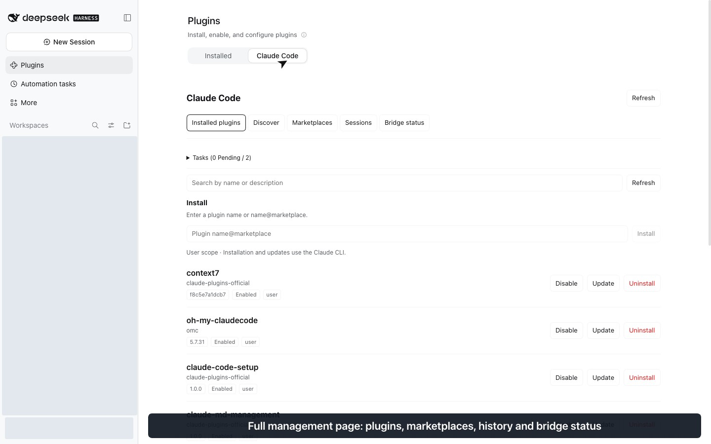
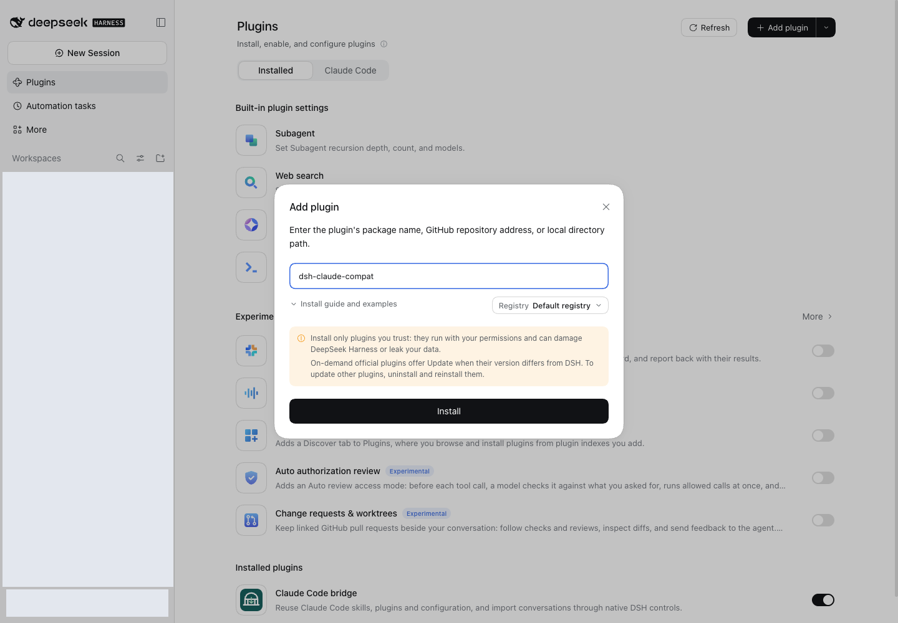
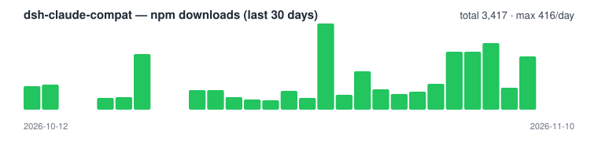

<p align="center">
  
</p>

<h1 align="center">dsh-claude-compat</h1>

<p align="center">
  <a href="README.zh-CN.md"></a>
  
  
  
  
</p>

> **Reuse your Claude Code configuration in DSH.**
> Bridge skills, commands, rules, agents, hooks and MCP, with documented runtime limits and upgrade guidance.

---

## The 10-second pitch

1. **Bring your Claude Code setup to DSH.** Reuse supported skills, slash commands, rules, agent definitions, hooks and MCP configuration from your existing `.claude/` directories.
2. **Manage Claude plugins inside DSH.** Browse installed plugins and marketplaces from **Plugins → Claude Code**, or open the manager in a conversation with `/cc-plugin`.
3. **Pick up context from Claude conversations.** Use `/cc-resume` to find and preview a past session, then ask DSH to read it and summarize the background, task state and next steps.

Skills can reload in the current session. MCP and hook configuration changes require a DSH restart; the [compatibility and upgrade notes](docs/readme/en/compatibility.md) describe the supported runtime boundaries.



## Demo video · 40 seconds

https://github.com/user-attachments/assets/795abf8f-bc05-4c34-849d-65c61f34afd7

[Watch / download the English MP4](docs/videos/dsh-claude-compat-interactive-en.mp4) · [中文版视频](docs/videos/dsh-claude-compat-interactive-zh-CN.mp4)

See the full plugin page, inline management cards, history handoff and a real skill response. The recording uses labelled demo history and a demo-only skill; private details are masked. [Recording source and editing notes](docs/demo-video/README.md).

## Quick start

**Install from the desktop / Web interface**

Open **Plugins → Add plugin**, enter `dsh-claude-compat`, then click **Install**. The fresh Web capture below shows the graphical installation entry.



**Install from the command line**

Requires **DSH 0.2.1-rc.2 or 0.2.2-rc.1**, with `pnpm` on `PATH`. **Node.js 24** is recommended.

```bash
dsh plugin --profile web add dsh-claude-compat@latest
dsh web
```

Restart DSH if it is already running. Your existing project and user-level `.claude/` configuration is read automatically. Only enable hooks from projects you trust.

| Command | Use |
|---|---|
| `/cc-plugin` | Manage Claude plugins and marketplaces |
| `/cc-resume` | Browse Claude history and continue with its context |
| `/reload-skills` | Refresh the current session's skill catalog |
| `/cc-export` | Export DSH skills to Claude Code |

[More installation options](docs/readme/en/installation.md) · [All command options](docs/readme/en/commands.md)

## Documentation

| Guide | Contents |
|---|---|
| [Installation](docs/readme/en/installation.md) | Requirements, update commands and assisted installation |
| [Commands and history](docs/readme/en/commands.md) | Plugin management, skill export, context handoff and legacy archives |
| [Configuration](docs/readme/en/configuration.md) | All parameters, defaults and environment variables |
| [Bridge behavior](docs/readme/en/bridge-behavior.md) | Supported assets, precedence, lifecycle and non-ASCII skill names |
| [Hooks](docs/readme/en/hooks.md) | Events, handlers and runtime limitations |
| [MCP servers](docs/readme/en/mcp.md) | Sources, transports, policy, credentials and compatibility gaps |
| [Compatibility and upgrades](docs/readme/en/compatibility.md) | Tested DSH versions and migration notes |
| [Troubleshooting](docs/readme/en/troubleshooting.md) | Missing skills, CLI errors, startup and archive issues |

## Changelog

[Release history](CHANGELOG.md) · [简体中文](CHANGELOG.zh-CN.md)

<details>
<summary>Community and project stats</summary>

## Acknowledgments

- [Linux.do](https://linux.do) — community
- [Claude Code](https://claude.com/claude-code) — the `.claude/` conventions this plugin bridges
- [DeepSeek Harness](https://www.npmjs.com/package/@deepseek-ai/dsh) — the runtime this plugin extends

## 📈 NPM Downloads



[Data: api.npmjs.org](https://www.npmjs.com/package/dsh-claude-compat) · [npmtrends](https://npmtrends.com/dsh-claude-compat/)

## ⭐ Star History

If this project helps you, please give it a ⭐ — it motivates us to keep improving.

<p align="center">
  
  
  
</p>

<div align="center">
  <a href="https://www.star-history.com/#biedongbin/dsh-claude-compat&Date">
    <picture>
      <source media="(prefers-color-scheme: dark)" srcset="https://api.star-history.com/svg?repos=biedongbin/dsh-claude-compat&type=Date&theme=dark" />
      <source media="(prefers-color-scheme: light)" srcset="https://api.star-history.com/svg?repos=biedongbin/dsh-claude-compat&type=Date" />
      
    </picture>
  </a>
</div>

</details>

## License

[MIT](LICENSE)
