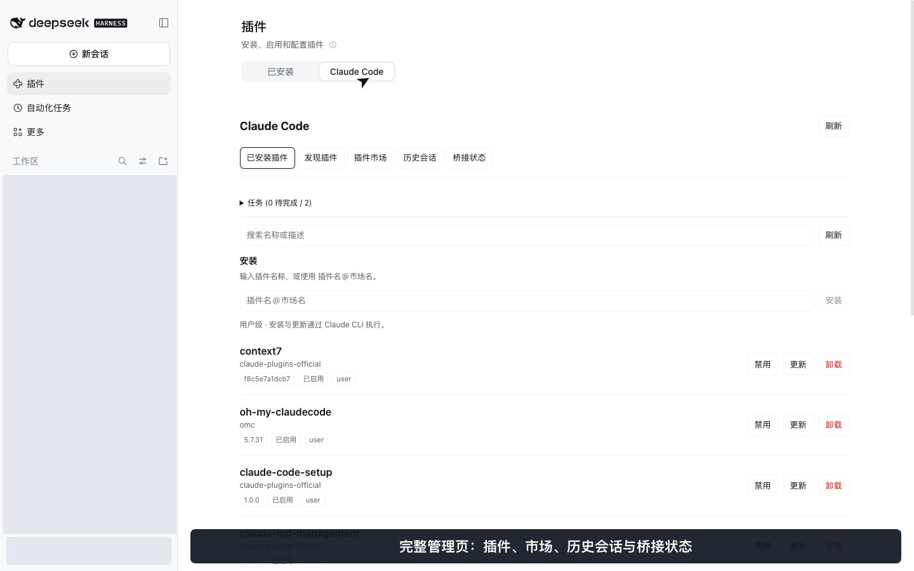
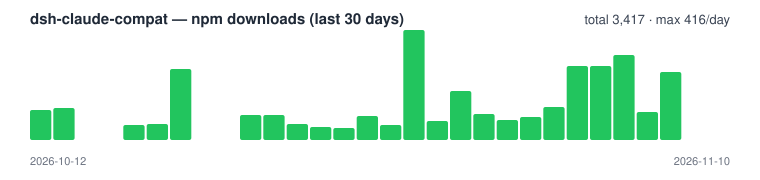

<p align="center">
  
</p>

<h1 align="center">dsh-claude-compat</h1>

<p align="center">
  <a href="README.md"></a>
  
  
  
  
</p>

> **在 DSH 中复用 Claude Code 配置。**
> 桥接 skills、命令、规则、agents、hooks 与 MCP，并明确说明运行时限制和升级步骤。

---

## 10 秒速览

1. **把 Claude Code 配置带到 DSH。** 复用已有 `.claude/` 目录中受支持的技能、斜杠命令、规则、代理定义、hooks 和 MCP 配置。
2. **在 DSH 内管理 Claude 插件。** 从 **插件 → Claude Code** 浏览已安装插件和市场，也可以用 `/cc-plugin` 在对话中打开管理界面。
3. **接着理解 Claude 会话中的任务。** 用 `/cc-resume` 查找、预览历史会话，再交给 DSH 阅读并总结背景、任务状态和下一步。

技能可在当前会话刷新；MCP 与 hook 配置变更需要重启 DSH。受支持的运行时及能力边界见[兼容与升级说明](docs/readme/zh-cn/compatibility.md)。



## 演示视频 · 34 秒

https://github.com/user-attachments/assets/429c9039-ec83-49c4-8ba9-7553cc7bc1f4

[观看／下载中文 MP4](docs/videos/dsh-claude-compat-interactive-zh-CN.mp4) · [English video](docs/videos/dsh-claude-compat-interactive-en.mp4)

展示完整插件页面、对话内管理卡片、历史接续和技能实际回复。录制使用明确标注的演示历史与临时演示技能，个人信息已遮盖。[录制源与剪辑说明](docs/demo-video/README.md)。

## 快速开始

需要 **DSH 0.2.1-rc.2 或 0.2.2-rc.1**，且 `PATH` 中可用 `pnpm`；推荐 **Node.js 24**。

```bash
dsh plugin --profile web add dsh-claude-compat@latest
dsh web
```

如果 DSH 已运行，请重启。插件会自动读取项目与用户级 `.claude/` 配置；仅启用可信项目中的 hooks。

| 命令 | 用途 |
|---|---|
| `/cc-plugin` | 管理 Claude 插件与市场 |
| `/cc-resume` | 浏览 Claude 历史并接续上下文 |
| `/reload-skills` | 刷新当前会话的技能目录 |
| `/cc-export` | 将 DSH 技能导出到 Claude Code |

[更多安装方式](docs/readme/zh-cn/installation.md) · [完整命令用法](docs/readme/zh-cn/commands.md)

## 使用文档

| 文档 | 内容 |
|---|---|
| [安装与更新](docs/readme/zh-cn/installation.md) | 环境要求、升级命令与辅助安装 |
| [命令与历史接续](docs/readme/zh-cn/commands.md) | 插件管理、技能导出、上下文接续和旧式归档 |
| [参数配置](docs/readme/zh-cn/configuration.md) | 全部参数、默认值和环境变量 |
| [桥接机制](docs/readme/zh-cn/bridge-behavior.md) | 支持内容、优先级、生效时机和中文技能名 |
| [Hooks](docs/readme/zh-cn/hooks.md) | 事件、处理器和运行时限制 |
| [MCP 服务器](docs/readme/zh-cn/mcp.md) | 来源、传输、策略、凭据与兼容边界 |
| [兼容与升级](docs/readme/zh-cn/compatibility.md) | 已验证的 DSH 版本与迁移说明 |
| [故障排查](docs/readme/zh-cn/troubleshooting.md) | 技能缺失、CLI 错误、启动和归档问题 |

## 更新日志

[版本历史](CHANGELOG.zh-CN.md) · [English](CHANGELOG.md)

<details>
<summary>社区与项目统计</summary>

## 社区鸣谢

- [Linux.do](https://linux.do) —— 社区
- [Claude Code](https://claude.com/claude-code) —— 本插件桥接的 `.claude/` 约定
- [DeepSeek Harness](https://www.npmjs.com/package/@deepseek-ai/dsh) —— 本插件扩展的运行时

## 📈 NPM 下载趋势



[Data: api.npmjs.org](https://www.npmjs.com/package/dsh-claude-compat) · [npmtrends](https://npmtrends.com/dsh-claude-compat/)

## ⭐ Star History

如果这个项目对你有帮助，请给个 ⭐ —— 这是我们持续改进的动力。

<p align="center">
  
  
  
</p>

<div align="center">
  <a href="https://www.star-history.com/#biedongbin/dsh-claude-compat&Date">
    <picture>
      <source media="(prefers-color-scheme: dark)" srcset="https://api.star-history.com/svg?repos=biedongbin/dsh-claude-compat&type=Date&theme=dark" />
      <source media="(prefers-color-scheme: light)" srcset="https://api.star-history.com/svg?repos=biedongbin/dsh-claude-compat&type=Date" />
      
    </picture>
  </a>
</div>

</details>

## License

[MIT](LICENSE)
