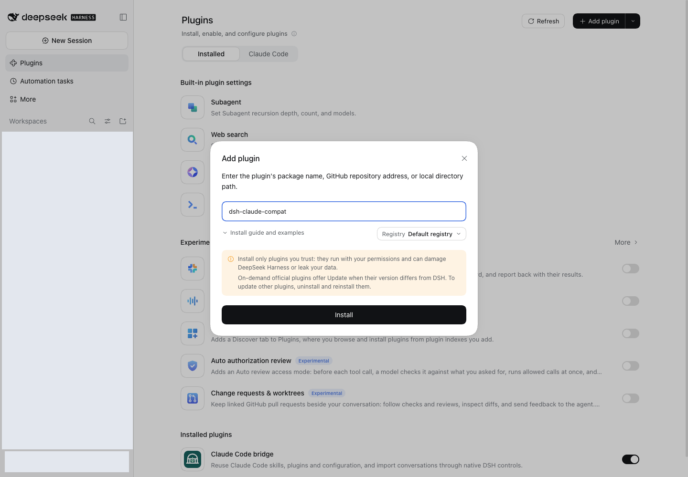

[← Project overview](../../../README.md) · [简体中文](../zh-cn/installation.md)

# Requirements

- DSH with a profile (e.g. `web`)
- A project using Claude Code conventions: `.claude/skills/`, `.claude/commands/`, `.claude/rules/`, `.claude/agents/`, `.claude/settings.json`, and a project-root `.mcp.json` (all optional; `~/.claude/` equivalents are also picked up)
- `pnpm` on `PATH` — `dsh plugin` is a thin pnpm forwarder

## Install / Update

### Install from the desktop / Web interface

Open **Plugins → Add plugin**, enter `dsh-claude-compat`, then click **Install**. The fresh Web capture below shows the graphical installation entry.



Only the package name was entered for this capture; no installation was submitted. If already installed, the interface may ask you to uninstall before reinstalling.

### Command line

One command — the package declares `dsh.bundle`, so DSH activates it automatically (no manual `cordis.patch.yml` editing). Install or update to the latest release:

```bash
dsh plugin --profile web add dsh-claude-compat@latest
```

Or from GitHub:

```bash
dsh plugin --profile web add github:biedongbin/dsh-claude-compat
```

Restart DSH (`dsh web`). Done — skills show up in `/`, rules are injected into every new session.

**Or ask DSH to install it:**

> Read https://github.com/biedongbin/dsh-claude-compat/blob/main/.claude/skills/install-dsh-compat/SKILL.md and install the dsh-claude-compat plugin following its steps.
